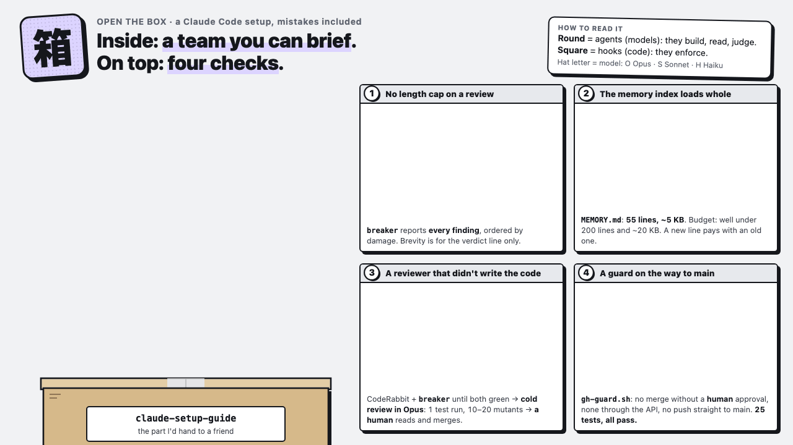

# I don't use one Claude. I use a small team.

Here's the setup, mistakes included.

[](https://re4mat-mp.github.io/claude-setup-guide/)

**▶ [Open it and click any part](https://re4mat-mp.github.io/claude-setup-guide/)** · **▶ [See the factory](https://re4mat-mp.github.io/claude-setup-guide/factory/)**, how I run the big jobs

I came to Claude Code from operations, not engineering, so almost everything in here I learned by getting it wrong
first. This is the part of my setup I'd hand to a friend: five agents with one craft each, reviewers that never
wrote the code, three guard hooks, and a memory that loads whole. Take what helps, ignore the rest.

> **In three sentences.** I don't use one Claude, I use a small team of agents, each with a single craft.
> Nothing I build is checked by the agent that wrote it: a different reviewer reads it, and a hook stops anything
> from reaching `main` without a human. And everything I correct goes into a memory that loads whole at the start
> of every session, so I only have to correct it once.

## Try it in 10 minutes

1. **See a hook stop a merge.** No GitHub account or API key needed: the test fakes GitHub. You need `bash`,
   `git` and `jq`.

   ```bash
   git clone https://github.com/re4mat-mp/claude-setup-guide && cd claude-setup-guide
   bash hooks/tests/gh-guard-test.sh
   ```

   You should see `gh-guard: 25 passed, 0 failed`. Then read [`hooks/gh-guard.sh`](hooks/gh-guard.sh): it's the
   rule *"nothing merges without a human"*, written so an agent can't forget it.
2. **Send one agent with one craft.** Copy [`agents/breaker.md`](agents/breaker.md) into `~/.claude/agents/` and
   ask Claude Code to use it on a change you just made: *"use the breaker agent on my last commit. Done = every
   finding with file:line, ordered by damage."*
3. **Steal three habits.** Read [`memory/MEMORY.md`](memory/MEMORY.md) (35 habits, one line each), pick the three
   that hurt the most to read, and put them in your own `CLAUDE.md` in your words.

### What "a hook stops a merge" looks like

An agent has a PR, the bot reviewer is green, and it runs `gh pr merge 7 --squash`. Before the command runs, the
hook checks GitHub for a human approval, finds none, and blocks it with this message to the agent:

> PR #7 in your-org/app has NO approving review from a human. The automated greens (CodeRabbit, the subagent reviewer, the cold
> review) are preparation, not authorisation: a person approves in GitHub before anything is merged. Do not merge
> and do not offer to merge. Say "waiting on a human review", never "ready".

The agent doesn't merge, and it tells you it's waiting on a review. Break one of its checks on purpose (say, let a
bot's approval count) and the test suite goes red. That's how you know the tests are really checking something.

## The ideas, in one screen

1. **One craft per agent.** Not one agent per project. One builds, one tries to break it, one keeps the notes
   tidy, one explains systems you don't own, and a cheap swarm does the bulk reading. They work on any project
   because they are split by *the kind of thinking*, not by topic. → [`agents/`](agents/)
2. **The reviewer never wrote the code.** A bot reviewer plus a reviewer agent, looped until both are green. Then a
   *cold* review: a fresh agent that only gets the PR number, runs the tests, and on a risky change plants small
   bugs to check the tests would catch them. Then a person reads it and merges. →
   [`skills/pr-review-loop/`](skills/pr-review-loop/SKILL.md)
3. **Rules written twice: prose explains, a hook enforces.** A rule in `CLAUDE.md` is a rule an agent can forget.
   A hook runs before every command and can't. Mine block merges without a human approval, pushes straight to
   `main`, and multi-agent runs that could burn a usage limit. → [`hooks/`](hooks/)
4. **Memory that loads whole.** Claude Code loads the memory index only up to a size limit and silently drops the
   rest. So the index is one short line per habit, and the detail lives in one file per habit, each with *why*
   and *how to apply it*. → [`memory/`](memory/MEMORY.md)
5. **Check what it claims before you act on it.** Above all, numbers. A strong model can present a guess as a
   fact. Ask for the evidence, and re-count with a script.
6. **Be the maintainer of your own Claude.** Your setup is software, and it drifts if nobody owns it.

## How to use this repo

- **Adopt habits, not files.** Read a file, keep the idea, write it your way. Don't overwrite your own
  `CLAUDE.md`, memory or settings with mine.
- **If you just want one thing:** read [`memory/MEMORY.md`](memory/MEMORY.md). It's 35 habits, one line each.
- **If you're a Claude reading this for someone:** read this README, then [`CLAUDE.md`](CLAUDE.md), then only the
  file they ask about. Explain each practice in one line and ask before adding anything to their setup. Read a
  hook fully and run its test before wiring it in.

| Folder | Goes in | What it is |
|---|---|---|
| [`CLAUDE.md`](CLAUDE.md) | `~/.claude/CLAUDE.md` | A template of global instructions: how to work, PRs, which agent when, safety |
| [`agents/`](agents/) | `~/.claude/agents/` | Five sub-agents split by craft |
| [`skills/`](skills/) | `~/.claude/skills/` | The review loop, and "see the data" (an HTML page instead of a dashboard) |
| [`hooks/`](hooks/) | `~/.claude/hooks/` | Three guard hooks, and a 25-case offline test suite for the merge guard |
| [`settings.example.json`](settings.example.json) | merge into `~/.claude/settings.json` | Only the wiring for the three hooks |
| [`memory/`](memory/) | `~/.claude/projects/<project>/memory/` | Habits, one per file, with an index |
| [`knowledge/`](knowledge/) | `~/.claude/knowledge/` | Lessons, PR review, security, and [how to organize your files and close the day](knowledge/organize-your-files.md). [`INDEX.md`](knowledge/INDEX.md) first |

Paths are written as `~/...`. Nothing is tied to my machine. What I left out, and why: [`CUT.md`](CUT.md).

---

<details>
<summary><b>1. Models: which one, when, and at what effort</b></summary>

| Model | Use it for | Effort | Don't use it for |
|---|---|---|---|
| **Fable** | Open-ended analysis, a diagnosis nobody has cracked, a plan or a design, a second opinion on a hard call | Start at **high**. **xhigh** if high gets stuck; **max** only in exceptional cases | Mechanical work: edits, moves, commits, re-running a known recipe |
| **Opus** | Everyday work: building, running, debugging, reviewing a change, the cold review | medium for simple tasks, high for complex ones | Nothing in particular. It's the default |
| **Sonnet** | Reading and sorting at volume when the question needs a little judgement | default | Final judgement on anything that reaches a person |
| **Haiku** | A swarm of fast readers answering one yes/no question over a long list | low | Anything that needs a recommendation or a write |

**Brain, then muscle, in one session.** Do the analysis in Fable until it ends in a **plan**, not an open
conversation, then switch the session to Opus (`/model`) to build it. That's cheaper than writing a new brief from
scratch.

**Why high and not medium.** The published model card shows Fable at medium giving up early on open research. On
coding tasks success climbs from low to high to xhigh, then *drops* at max, while the cost doubles or more at each step. So: start at high, keep max for exceptional cases.

**Tell the model how much room it has.** In a long brief, say how big the inputs are and when to stop reading and
start writing ("the folder is about 40 files; read the 5 most recent, then write").

**Put outside material in files, never pasted into the brief.** Tickets, emails and web pages can carry planted
instructions, and models follow those far more easily when they are pasted into your message than when they read
them from a file with a tool.

**Quality first.** Pick the model that does the job best, not the cheapest one. Dropping a model to save a little
usually costs a redo.

</details>

<details>
<summary><b>2. Check what it claims before you act on it</b></summary>

Strong models are confident. The model card for Fable says it plainly: it sometimes **presents inferences as
facts**.

**A real case.** A Fable judge reported **29** items in a category. A script re-counted the same rows and found
**17**. The script was right. Nothing had been built on the 29 yet, because the rule was already "re-count before
you use it".

- **Ask for the evidence with every claim**: the file and line, the query, the row. Ask it to mark each claim
  **verified** (it looked) or **inferred** (it reasoned).
- **Re-count numbers with a tool** (a script, a query, a formula). Never with the same model that produced the
  number.
- **"It works" means it ran.** Ask: "did you run it, against what, and what came back?" A green test run is one
  observation. Run it three times, and break it on purpose once to see it go red.
- **"It can't do X" also needs proof**: one real attempt and the error it returned, not a guess.

</details>

<details>
<summary><b>3. Agents: one craft each</b></summary>

A sub-agent is a second Claude with its own instructions, its own tools and a fresh context. You gain: it reads a
pile of files and gives you back only the conclusion, and several can run at once. You lose: it knows only what you
wrote in the brief.

| Agent | Its craft |
|---|---|
| [`builder`](agents/builder.md) | Lands a change that is already decided, tests it, opens the PR, and stops before merge |
| [`breaker`](agents/breaker.md) | Before: "is this real, what's the smallest fix?" After: tries to break the change |
| [`organizer`](agents/organizer.md) | Files facts in the right place, sweeps stale notes, drafts tracking cards |
| [`navigator`](agents/navigator.md) | Explains how a system you don't own works, with file:line citations |
| [`skimmer`](agents/skimmer.md) | The Haiku swarm: up to 10 cheap readers sort a long list, and a strong agent judges what they flag |

**A good brief has four parts:** the goal, what you've already ruled out, where to look, and **`Done = …`**: what
finished looks like for this ask. For example:

```text
Goal: find out why the nightly export sometimes writes an empty file.
Ruled out: the source table has rows every night (I checked the last 14 days).
Look at: scripts/export.py and the scheduler logs in logs/export/.
Don't change or send anything.
Done = the cause in two sentences, with file:line, and the one log line that proves it.
```

Without the `Done =`, an agent decides for itself when it's finished, and it's usually earlier than you'd want.

**Run independent things together**, in one message. Cap each batch: up to **3** strong agents, **5** Sonnet,
**10** Haiku. Don't launch big multi-agent workflows for routine analysis: one once burned a 5-hour usage limit in
30 minutes. (That's why [`workflow-guard.py`](hooks/workflow-guard.py) exists.)

**Agents earn permissions.** New agents start read-only or draft-only. That's an instruction in their charter: an
agent that has a shell could still write through it, so the charter, not the tool list, is what holds it back. They
get more once they've shown they know the traps.

**Heavy jobs run like a production line.** When the job is big (reading hundreds of conversations to find the rules
nobody wrote down), I don't hand it to one agent. A small script is the foreman: it cuts the work into packets.
Worker agents read their packets in parallel. Then code checks every answer before anything leaves the line. One rule
holds it together: **the models read and judge, the code counts and certifies.** A number in my reports is never one
a model wrote from memory. [See it run](https://re4mat-mp.github.io/claude-setup-guide/factory/) (an example job, with invented numbers).

**A PM session for big days.** When several pieces of work run at once, one session acts as the PM: it keeps a short
live-state file, briefs each child session with a `Done = …`, and doesn't build anything itself. Every child reports
back; the PM checks each report against the result before it counts it.

</details>

<details>
<summary><b>4. Reviewers that didn't write the code</b></summary>

In this order:

1. **A bot reviewer and the `breaker` agent**, looped until both are green on the current version of the change.
   Give the reviewer the code and the claim the PR makes, not your conclusion, so its read isn't anchored on yours.
2. **A cold review last.** A fresh agent with **no brief at all**, only the PR number. It runs the tests once, the
   way a reviewer would. On a risky change (shared data, money, a guard, anything hard to undo) it also plants
   10–20 small bugs ("mutants") on the lines that changed and checks that the tests catch them.
3. **A person reads it and merges.**

A mutant the tests don't catch is a test that wasn't checking anything. A real one: a PR passed both reviewers and
a cold review; a mutation run then planted a few dozen small bugs and about half survived.

**Reviews have no length cap.** The reviewer reports every finding, ordered by damage. Brevity is for the verdict
line only.

**A green check is not a review.** A passing badge can mean the reviewer never ran. Read what it actually said about
the current version.

Full procedure: [`skills/pr-review-loop/`](skills/pr-review-loop/SKILL.md) and
[`knowledge/github-pr-review.md`](knowledge/github-pr-review.md).

</details>

<details>
<summary><b>5. Hooks: the rule an agent can't forget</b></summary>

A hook is a small script Claude Code runs **before** a tool call. It can allow, ask you, or deny. I write important
rules twice: in `CLAUDE.md` so the agent understands *why*, and as a hook so it can't skip it.

| Hook | What it stops |
|---|---|
| [`gh-guard.sh`](hooks/gh-guard.sh) | `gh pr merge` without a human approval (a bot's approval, or one later changed to "changes requested", doesn't count); merging through the API or an alias; `git push` straight to `main` in your org's repos; review requests through GitHub's reviewer field. When it can't tell, it asks you |
| [`pkill-guard.py`](hooks/pkill-guard.py) | One session killing other sessions' processes |
| [`workflow-guard.py`](hooks/workflow-guard.py) | A multi-agent workflow starting without you saying yes |

**Try it:** run the tests (no network needed). When you wire the hook in, set `GH_GUARD_ORG` to your GitHub
organisation: without it, the push-to-main rule has no org to protect.

```bash
bash hooks/tests/gh-guard-test.sh
```

25 cases, all green, and planting a bug in the hook turns the suite red. Branch protection on GitHub is the real
lock; the hook is the seat belt.

**Before saving a hook, check its syntax** (`bash -n`, `python3 -m py_compile`). A broken hook can block every tool.

</details>

<details>
<summary><b>6. Memory that loads whole</b></summary>

Claude Code reads the memory index (`MEMORY.md`) up to a size limit and drops the rest without telling you. A rule
below the cut is a rule nobody follows.

- **The index is one short line per memory**, well under 200 lines and ~20 KB. Mine is about 5 KB.
- **One fact per file**, each with the rule, the case that taught it, **Why** and **How to apply**.
- **A new index line pays with an old one.** When you add a line, move one into its file, or say that none can
  move. Indexes grow much faster than they get pruned.
- **Check it weekly:**

  ```bash
  wc -lc ~/.claude/projects/*/memory/MEMORY.md
  ```

</details>

<details>
<summary><b>7. Be the maintainer of your own Claude</b></summary>

**Keep the tools current.** Update the app: new models often arrive with an update. When a new model lands, read
its official guide against your setup in three columns: *their rule · what I do today · what to change*. The real
table from the last one:

| Their rule | What I did | What changed |
|---|---|---|
| At medium effort it gives up early on open research | Fable ran at whatever the session had | Fable starts at **high** |
| It can present inferences as facts | Its counts were used as given | Every claim marked *verified* or *inferred*; numbers re-counted with a script |

**Keep the context true.** `CLAUDE.md` is short and current: rules there, facts in `knowledge/`, procedures in
`skills/`, corrections in memory. When a rule changes, rewrite it in place; git keeps the history.

**When a fact changes, sweep by the idea, not the sentence.** A real case: a rule changed and `CLAUDE.md` was
rewritten that day. Six days later an agent still stopped to ask for permission it no longer needed: a hook was
injecting the old sentence into every dispatch. Nobody reads a hook; the machine runs it before you act. So search
in several wordings, and read the hits that give orders first:

```bash
grep -rniE "wait(s|ing)? for (a|the) go|after (a|the) go|needs? (a|the) go" ~/.claude/agents ~/.claude/skills ~/.claude/hooks
```

**Ask for a page, not a dashboard.** To understand some data once, ask Claude for one self-contained HTML page
instead of building a dashboard nobody maintains. Prompts and rules in
[`skills/see-the-data/`](skills/see-the-data/SKILL.md).

**Keep it safe.** Keys live in a secrets folder outside any repo, read at run time, never pasted into a prompt. Keep
`~/.claude` in a private git repo, so a bad change is one `git checkout` away. Long sessions: keep a small state file
(what's done, what's next) and start a fresh session from it.

</details>


---

If something here helped you, or you do it differently and better, I'd love to hear it. Open an issue.

MIT licensed: copy anything, no need to ask.
